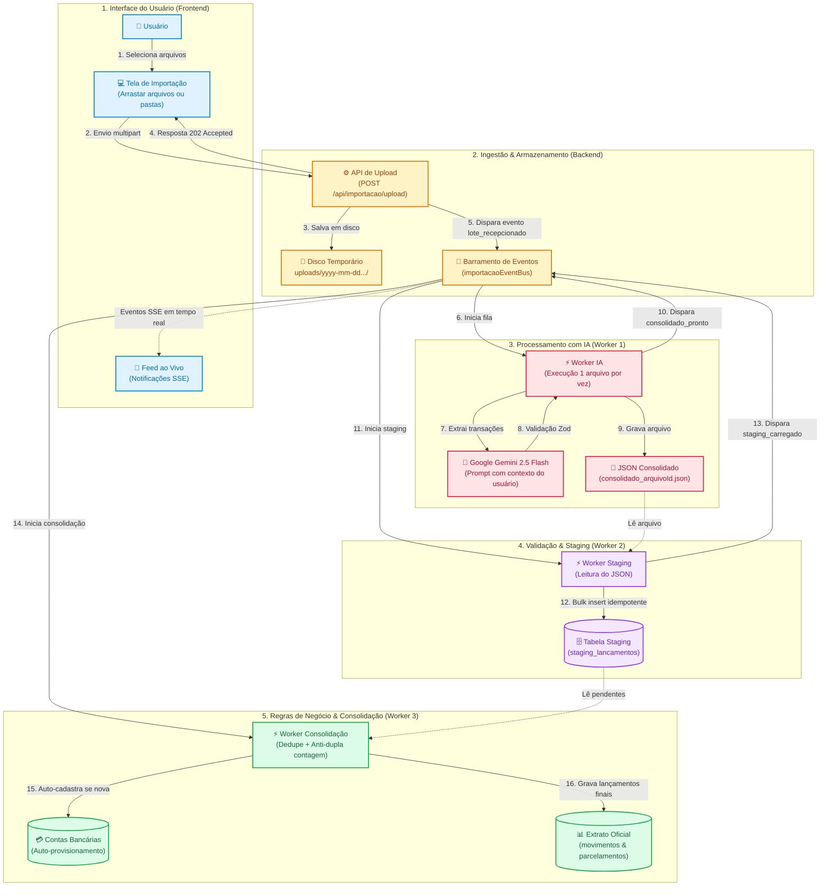
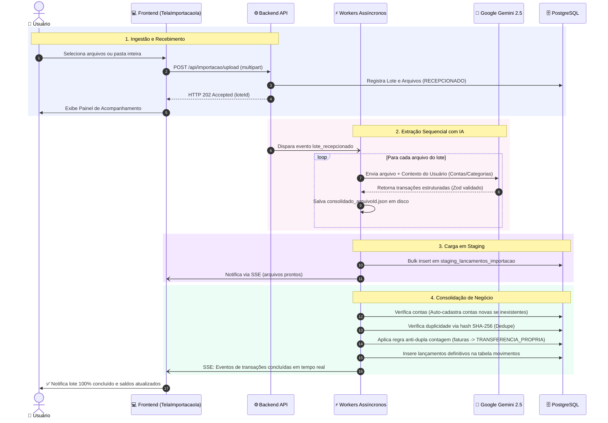

# 🤖 Fluxo Completo de Importação de Lançamentos com IA (Plano A)

Este documento descreve de forma didática e visual a arquitetura e o ciclo de vida completo da **Importação Inteligente de Lançamentos por IA**, desde o upload de documentos até a efetivação no extrato financeiro do usuário logado.

---

## 📌 Visão Panorâmica da Arquitetura

O ecossistema é organizado em **5 camadas claras e sequenciais** (*Frontend*, *Ingestão*, *Motor IA*, *Staging* e *Consolidação*):



---

## 🧭 Diagrama de Sequência e Interações no Tempo



---

## 🔄 Detalhamento das 5 Etapas do Pipeline

### 1. Seleção e Envio no Frontend ([`TelaImportacaoIa.tsx`](../web/src/screens/TelaImportacaoIa.tsx))
- **Seleção flexível:** O usuário pode arrastar múltiplos arquivos (`.pdf`, `.csv`, `.ofx`, `.txt`, imagens) ou selecionar uma pasta inteira do computador.
- **Resposta imediata:** O upload responde com código `HTTP 202 Accepted`, liberando a interface instantaneamente.
- **Painel de Acompanhamento:** A tela transiciona para um monitor com barra de progresso e feed de atividades ao vivo via SSE (*Server-Sent Events*).

---

### 2. Ingestão e Armazenamento ([`ImportacaoStorageService`](../src/modules/importacao/importacao-storage.service.ts))
- **Diretório seguro:** Arquivos salvos em pasta física isolada:
  ```
  uploads/yyyy-mm-dd-hh-mm-ss-{usuarioId}/
  ```
- **Sanitização de caminhos:** Bloqueio de *Path Traversal* (rejeição de `../` e paths absolutos).
- **Rastreabilidade:** Criação de registros de auditoria em `lotes_importacao` e `arquivos_importacao`.

---

### 3. Extração Sequencial por IA ([`ImportacaoIaWorkerService`](../src/modules/importacao/worker/importacao-ia-worker.service.ts))
- **Execução 1 a 1:** Os arquivos são processados sequencialmente para proteger quotas e evitar *rate limits*.
- **Injeção de contexto:** O worker envia ao Gemini o histórico de contas bancárias e a árvore POF do usuário logado.
- **Extração rica:** O modelo ([`GeminiIaExtratorClient`](../src/modules/importacao/worker/ia-extrator.client.ts)) extrai data, valor, natureza, conta sugerida, categoria POF e parcelamentos.
- **Validação estrita:** Schema Zod ([`arquivoConsolidadoIaSchema`](../src/modules/importacao/worker/ia-extrator.schema.ts)) garante tipagem precisa antes da gravação do JSON intermediário.

---

### 4. Carga em Staging ([`ImportacaoStagingWorkerService`](../src/modules/importacao/worker/importacao-staging-worker.service.ts))
- **Área de quarentena:** As transações extraídas do JSON são gravadas na tabela temporária `staging_lancamentos_importacao`.
- **Idempotência:** Garante que falhas parciais possam ser reexecutadas sem corromper os dados do usuário.

---

### 5. Consolidação e Gravação Oficial ([`ImportacaoConsolidacaoWorkerService`](../src/modules/importacao/worker/importacao-consolidacao-worker.service.ts))
- **Auto-Cadastro de Contas:** Se o documento trouxer uma conta nova (ex: "Nubank Cartão"), o sistema provisiona a conta automaticamente no banco sem travar a importação.
- **Anti-Dupla Contagem:** Pagamentos de faturas de cartão são convertidos para `TRANSFERENCIA_PROPRIA`, impedindo somas duplicadas nas despesas.
- **Deduplicação Determinística:** Hash `SHA-256(contaId + data + valor + descricao)` descarta automaticamente lançamentos já existentes.
- **Gravação Definitiva:** Grava os registros em `movimentos` (status `CONCILIADO`) e atualiza o lote para `CONCLUIDO`.

---

## 🔒 Matriz de Segurança e Integridade

| Pilar | Mecanismo de Proteção |
|---|---|
| **Multi-Tenancy** | Todas as operações são isoladas estritamente pelo `usuarioId` autenticado. |
| **Sanitização** | Bloqueio rigoroso contra ataques de navegação em diretórios (*Path Traversal*). |
| **Anti-Duplicação** | Hash SHA-256 impede reimportação acidental de extratos repetidos. |
| **Anti-Dupla Contagem** | Regra inteligente para pagamentos de cartão de crédito. |
| **Estabilidade de Quota** | Fila sequencial de IA impedindo estouro de concorrência. |

---

## 🛠️ Endpoints REST da Importação

| Método | Rota | Descrição |
|---|---|---|
| `POST` | `/api/importacao/upload` | Envia arquivos ou pastas para início do pipeline (HTTP 202). |
| `GET` | `/api/importacao/lotes` | Lista os lotes de importação do usuário. |
| `GET` | `/api/importacao/lotes/:id` | Status detalhado de arquivos e progresso do lote. |
| `GET` | `/api/importacao/lotes/:id/staging` | Consulta transações em staging para auditoria. |
| `GET` | `/api/importacao/stream-eventos` | Streaming Server-Sent Events (SSE) com atualizações em tempo real. |
| `POST` | `/api/importacao/lotes/:id/processar-ia` | Disparo manual/contingência da etapa de IA. |
| `POST` | `/api/importacao/lotes/:id/carregar-staging` | Disparo manual da etapa de staging. |
| `POST` | `/api/importacao/lotes/:id/consolidar` | Disparo manual da etapa de consolidação final. |
