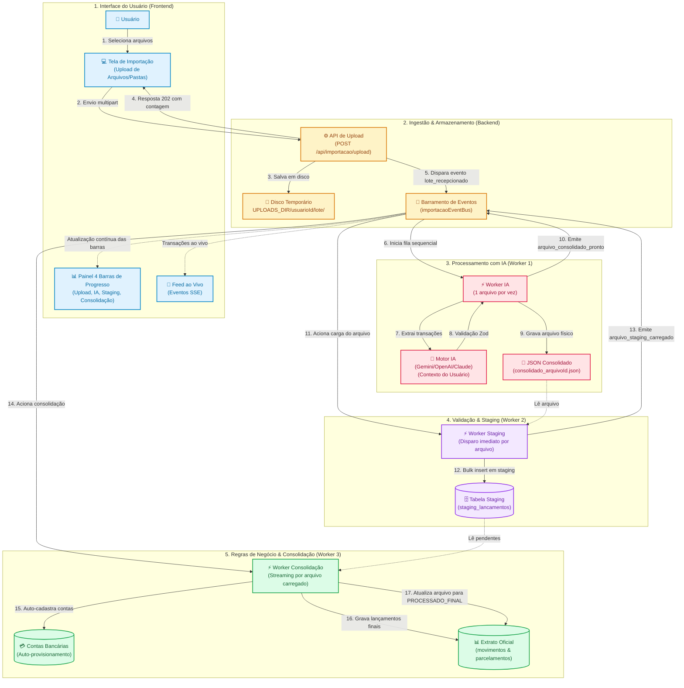
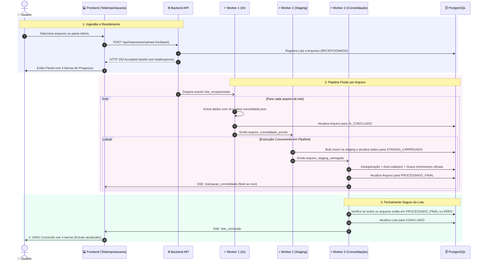

# 🤖 Fluxo Completo de Importação de Lançamentos com IA (Plano A)

Este documento descreve de forma didática e visual a arquitetura e o ciclo de vida completo da **Importação Inteligente de Lançamentos por IA**, desde o upload de documentos até a efetivação no extrato financeiro do usuário logado.

---

## 📌 Visão Panorâmica da Arquitetura Contínua e Assíncrona

O ecossistema opera como uma **esteira contínua assíncrona orientada a eventos**. O upload apenas recepciona e persiste os arquivos no disco e no banco; a partir deste momento, os workers trabalham de forma fluida sem bloqueios globais:

- **Worker 1 (IA):** Lê e extrai os lançamentos de cada arquivo de forma sequencial (1 arquivo por vez).
- **Worker 2 (Staging):** **Não espera** a IA processar todos os arquivos do lote. Assim que a IA conclui um arquivo (`EVENT_ARQUIVO_CONSOLIDADO_PRONTO`), este arquivo é imediatamente carregado na tabela de Staging.
- **Worker 3 (Consolidação):** **Não espera** todos os arquivos. Conforme cada arquivo entra na Staging (`EVENT_ARQUIVO_STAGING_CARREGADO`), o Worker 3 consolida seus lançamentos, provisiona contas e aplica deduplicação. O lote só é marcado como `CONCLUIDO` quando **todos** os arquivos atingirem status terminal (`PROCESSADO_FINAL` ou `ERRO`).



---

## 🧭 Diagrama de Sequência e Interações no Tempo



---

## 🔄 Detalhamento das 5 Etapas do Pipeline

### 1. Seleção e Envio no Frontend ([`TelaImportacaoIa.tsx`](../web/src/screens/TelaImportacaoIa.tsx))
- **Seleção flexível:** O usuário pode arrastar múltiplos arquivos (`.pdf`, `.csv`, `.ofx`, `.txt`, imagens) ou selecionar uma pasta inteira do computador.
- **Contagem Imediata:** Ao subir o lote, já registra a quantidade total de arquivos no banco.
- **Painel de 4 Barras de Progresso Independentes:**
  1. **Upload & Storage:** `X de N (100%)` - arquivos físicos persistidos no servidor.
  2. **Extração IA:** `X de N (% concluída)` - contagem exata de arquivos já lidos pelo modelo.
  3. **Carga Staging:** `X de N (% concluída)` + total de linhas inseridas na staging.
  4. **Consolidação Final:** `X de N (% concluída)` + total de lançamentos oficiais criados no extrato.
- **Telas de Detalhe por Worker:** Abas específicas com visão granular para o *Worker 1 (IA)*, *Worker 2 (Staging)* e *Worker 3 (Consolidação)*.
- **Botões Automáticos com Modo Contingência:** Todo o fluxo ocorre de forma automática e assíncrona; os botões manuais passam a ser utilizados apenas como opção de contingência ou re-tentativa.

---

### 2. Ingestão e Armazenamento ([`ImportacaoStorageService`](../src/modules/importacao/importacao-storage.service.ts))
- **Diretório seguro:** Arquivos salvos em pasta física isolada, com **uma subpasta por usuário**:
  ```
  {UPLOADS_DIR}/{usuarioId}/yyyy-mm-dd-hh-mm-ss-{usuarioId}/
  ```
  `UPLOADS_DIR` vem da variável de ambiente homônima (padrão: `uploads`, relativo à raiz do projeto). O caminho persistido em `LoteImportacao.caminhoDiretorio` permanece **relativo** quando `UPLOADS_DIR` é relativo, e é resolvido pelos leitores via `path.resolve(process.cwd(), caminhoDiretorio)`.
- **Sanitização de caminhos:** Bloqueio de *Path Traversal* (rejeição de `../` e paths absolutos).
- **Rastreabilidade no Banco:** Criação atômica em `lotes_importacao` e `arquivos_importacao` com status inicial `RECEPCIONADO`.

---

### 3. Extração Sequencial por IA ([`ImportacaoIaWorkerService`](../src/modules/importacao/worker/importacao-ia-worker.service.ts))
- **Execução 1 a 1:** Os arquivos são processados sequencialmente para proteger quotas e evitar *rate limits*.
- **Injeção de contexto:** O worker envia ao modelo o histórico de contas bancárias e a árvore POF do usuário logado.
- **Disparo Imediato:** Ao concluir cada arquivo, emite imediatamente `EVENT_ARQUIVO_CONSOLIDADO_PRONTO`, destravando o próximo worker.

---

### 4. Carga em Staging ([`ImportacaoStagingWorkerService`](../src/modules/importacao/worker/importacao-staging-worker.service.ts))
- **Execução por Arquivo:** Não espera o lote todo terminar na IA; processa cada arquivo individualmente assim que liberado.
- **Bulk Insert Otimizado:** Insere todos os registros do arquivo em lote via `prisma.stagingLancamentoImportacao.createMany`.
- **Disparo da Consolidação:** Emite `EVENT_ARQUIVO_STAGING_CARREGADO` com a contagem de linhas geradas.

---

### 5. Consolidação e Gravação Oficial ([`ImportacaoConsolidacaoWorkerService`](../src/modules/importacao/worker/importacao-consolidacao-worker.service.ts))
- **Auto-Cadastro de Contas:** Provisiona automaticamente contas bancárias e cartões novos sem travar a importação.
- **Anti-Dupla Contagem:** Pagamentos de faturas de cartão são convertidos para `TRANSFERENCIA_PROPRIA`, impedindo somas duplicadas nas despesas.
- **Deduplicação Determinística:** Hash `SHA-256(contaId + data + valor + descricao)` descarta automaticamente lançamentos já existentes (`IGNORADO`).
- **Conclusão Segura do Lote:** O status `CONCLUIDO` do lote só é atribuído quando **todos** os arquivos tiverem sido finalizados (`PROCESSADO_FINAL` ou `ERRO`), impedindo finalizações prematuras.

---

## 🔒 Matriz de Segurança e Integridade

| Pilar | Mecanismo de Proteção |
|---|---|
| **Multi-Tenancy** | Todas as operações são isoladas estritamente pelo `usuarioId` autenticado. |
| **Sanitização** | Bloqueio rigoroso contra ataques de navegação em diretórios (*Path Traversal*). |
| **Anti-Duplicação** | Hash SHA-256 impede reimportação acidental de extratos repetidos. |
| **Anti-Dupla Contagem** | Regra inteligente para pagamentos de cartão de crédito. |
| **Integridade de Lote** | O lote só é encerrado quando todos os arquivos atingem estado terminal. |

---

## 🛠️ Endpoints REST da Importação

| Método | Rota | Descrição |
|---|---|---|
| `POST` | `/api/importacao/upload` | Envia arquivos ou pastas para início do pipeline (HTTP 202). |
| `GET` | `/api/importacao/lotes` | Lista os lotes de importação do usuário. |
| `GET` | `/api/importacao/lotes/:id` | Status detalhado com métricas reais para as 4 barras de progresso. |
| `GET` | `/api/importacao/lotes/:id/staging` | Consulta transações em staging para auditoria e monitoramento. |
| `GET` | `/api/importacao/stream-eventos` | Streaming Server-Sent Events (SSE) com atualizações em tempo real. |
| `POST` | `/api/importacao/lotes/:id/processar-ia` | Disparo manual/contingência da etapa de IA. |
| `POST` | `/api/importacao/lotes/:id/carregar-staging` | Disparo manual/contingência da etapa de staging. |
| `POST` | `/api/importacao/lotes/:id/consolidar` | Disparo manual/contingência da etapa de consolidação final. |

